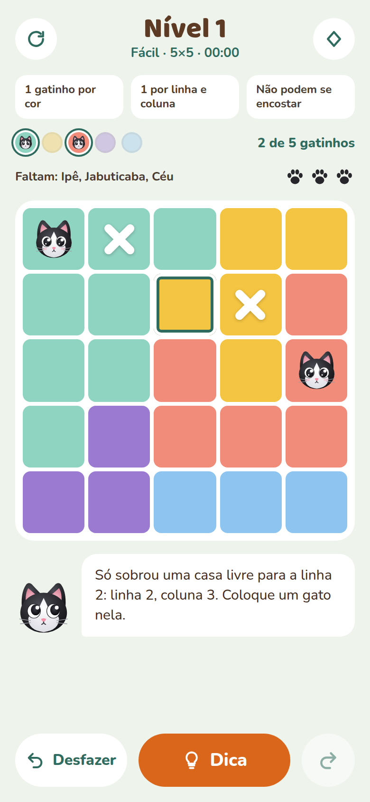
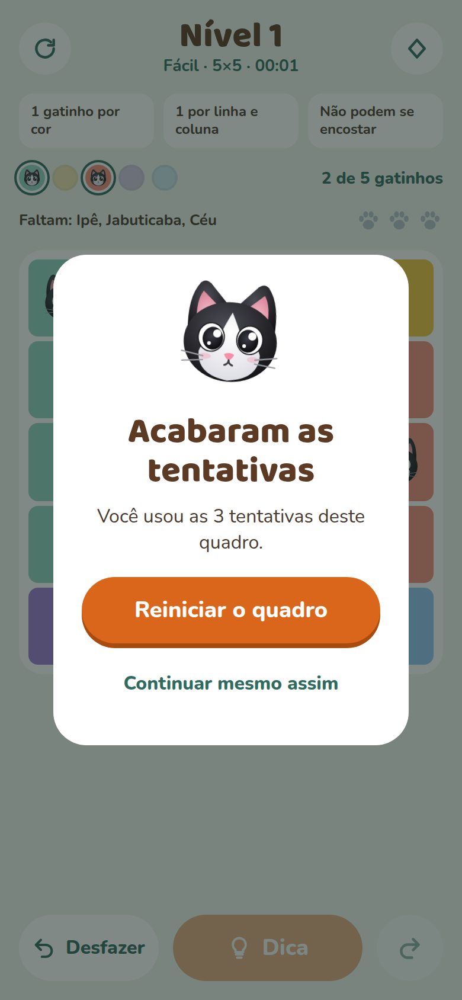

<h1 align="center">🐱 Gatinhos</h1>

<p align="center">
  Um quebra-cabeça zen de lógica: ache o gatinho escondido em cada cor.<br/>
  <a href="https://paulokmatos.github.io/gatinhos/"><b>▶ Jogar agora</b></a> · funciona no navegador e instala como app (PWA)
</p>

<p align="center">
  
  &nbsp;&nbsp;
  
</p>

## 📜 Como jogar

O tabuleiro é dividido em **regiões coloridas**. Seu objetivo é encontrar **um gatinho em cada região**, seguindo três regras:

| | Regra |
|---|---|
| 🎨 | **1 gatinho por cor** |
| ↔️↕️ | **1 gatinho por linha e por coluna** |
| 🚫 | **Gatinhos não podem se encostar**, nem na diagonal |

Quando todos os gatinhos forem achados, a fase termina. 🎉

### Controles

- **Toque numa casa:** vazia → **✕** → **🐱**.
  O ✕ é só o *seu rascunho* ("aqui não tem gatinho"). Ele **nunca** é marcado sozinho e pode até estar errado.
- **Arraste** o dedo (ou o mouse) sobre casas vazias para riscar várias de uma vez.
- **Desfazer / Refazer** voltam e repetem suas jogadas.
- **Reiniciar** (canto superior esquerdo) limpa o quadro.
- **◇** (canto superior direito) liga os **símbolos nas cores**, para ajudar quem tem dificuldade de distinguir tons.

### Tentativas e progresso

- Você tem **3 tentativas por quadro** (as patinhas ao lado do quadro). Gasta uma quando tenta colocar o gatinho (2º toque num ✕) numa casa que **não** é dele. Desfazer não devolve tentativa.
- Acima do tabuleiro, as bolinhas mostram **quais cores já têm gatinho** (com o gatinho dentro) e quais ainda faltam, com os nomes ao lado.
- Se alguma marcação ✕ estiver sobre um gatinho de verdade, aparece um aviso — sem dizer onde.

<p align="center">
  
  &nbsp;&nbsp;
  
</p>

- **Acabaram as tentativas?** Você escolhe: **Reiniciar o quadro** (recomendado) ou **Continuar mesmo assim**.
- **Venceu?** Um aviso mostra seu tempo e as dicas usadas, com botão para a **próxima fase** (e um ✕ para fechar e admirar o tabuleiro).

## 💡 3 dicas para começar

1. **Comece pelas cores pequenas.** Uma região com poucas casas (ou numa linha/coluna só) tem pouquíssimos lugares possíveis para o gatinho.
2. **Gatinho achado = risque ao redor.** Na linha, na coluna, na mesma cor e nas 8 casas vizinhas, ninguém mais pode ficar. Marque ✕ nelas para limpar a cabeça.
3. **Travou? Peça a Dica.** Toque em **Dica** até 3 vezes: 1º mostra *onde olhar*, 2º explica *o raciocínio*, 3º oferece **Aplicar**. Só aplicar conta como dica usada.

---

## 🛠️ Desenvolvimento

```sh
npm install
npm run dev        # servidor local
npm test           # testes automatizados (Vitest)
npm run build      # typecheck + build de produção
```

**Estrutura**

- `src/core/` — lógica pura e testável: modelo, validador, gerador (seed + unicidade), solver de força bruta, solver humano T1–T7, dicas, estado do jogo (desfazer, tentativas), persistência.
- `src/ui/` — interface (toque/arrasto, dicas, modais). A geração das fases roda num Web Worker.
- `tests/` — testes por marco; cada um cita o critério de aceite (CA01–CA25).
- `docs/` — imagens deste README.

**Técnicas do solver humano** (usadas na dificuldade e nas dicas): T1 único · T2 cor numa linha/coluna · T3 linha/coluna numa cor · T4 vizinhança · T5 N cores em N linhas/colunas · T6 N linhas/colunas em N cores · T7 hipótese de profundidade 1.
Dificuldade: T1–T2 Fácil, T3–T4 Médio, T5–T6 Difícil, T7 Expert.

**CI** (`.github/workflows/ci.yml`): typecheck + testes → build → deploy no GitHub Pages (só em `main`).
Para **pular os testes**: `[skip tests]` na mensagem do commit, label `skip-tests` no PR, ou "Pular os testes" ao disparar manualmente. O build e o deploy continuam rodando.

**Pendente no aparelho:** CA03 (arrasto), CA09 (long task), CA17, CA21–CA25 (instalação, offline, safe areas, roteiro no iPhone).
