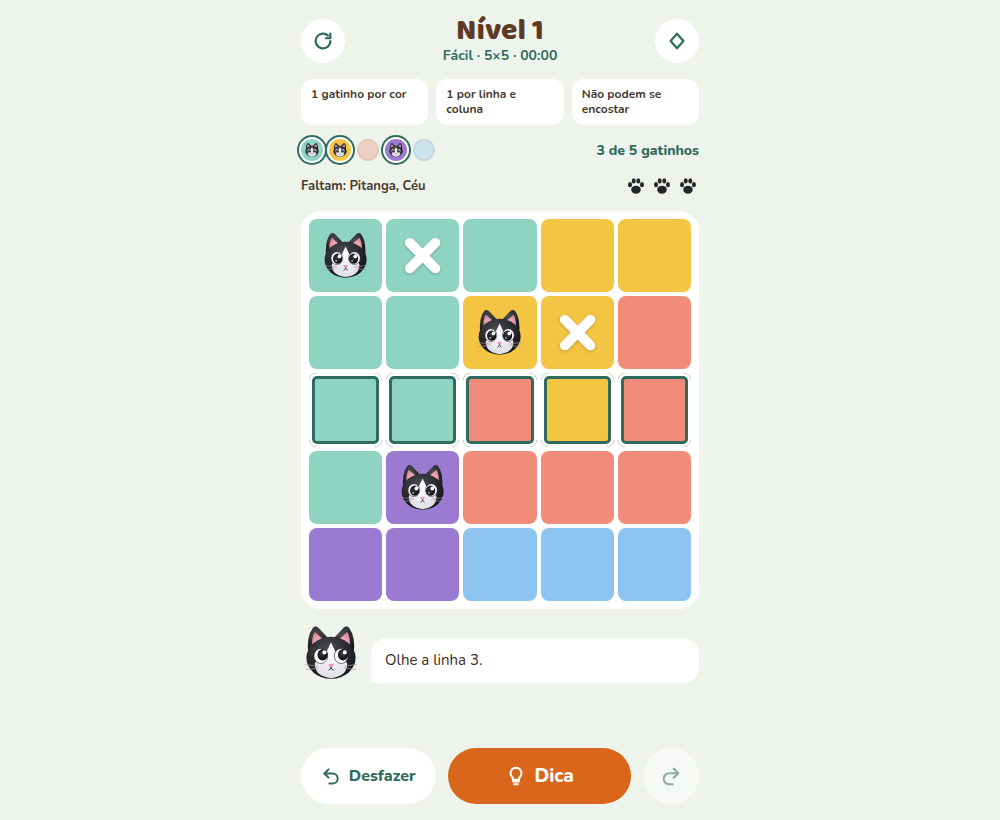
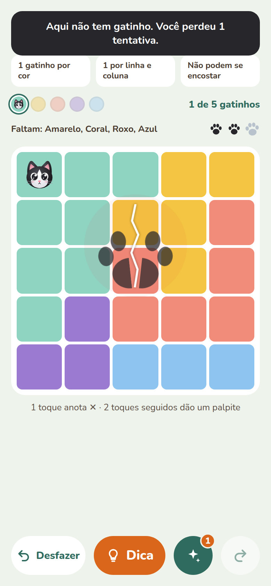
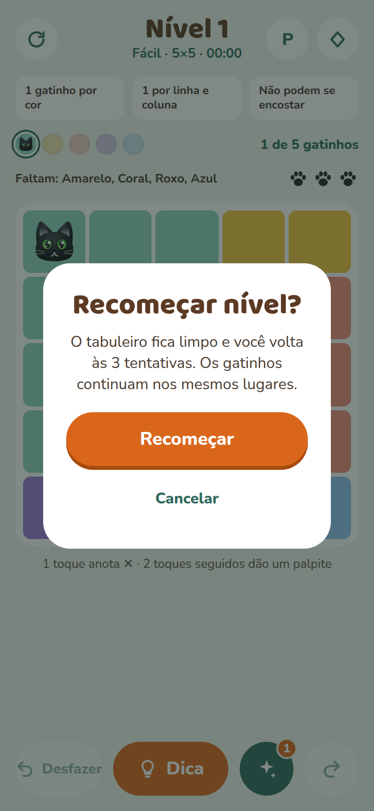
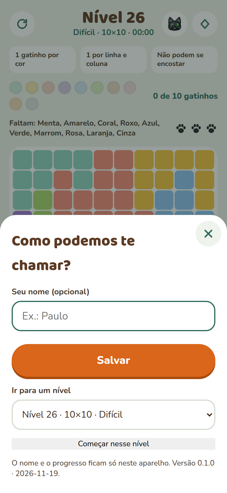
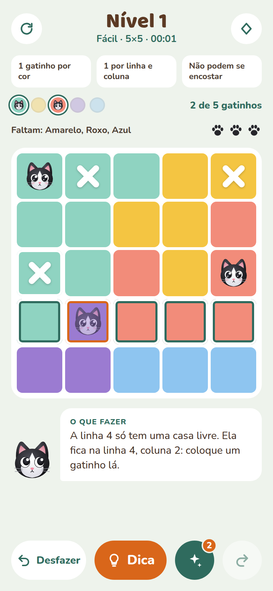
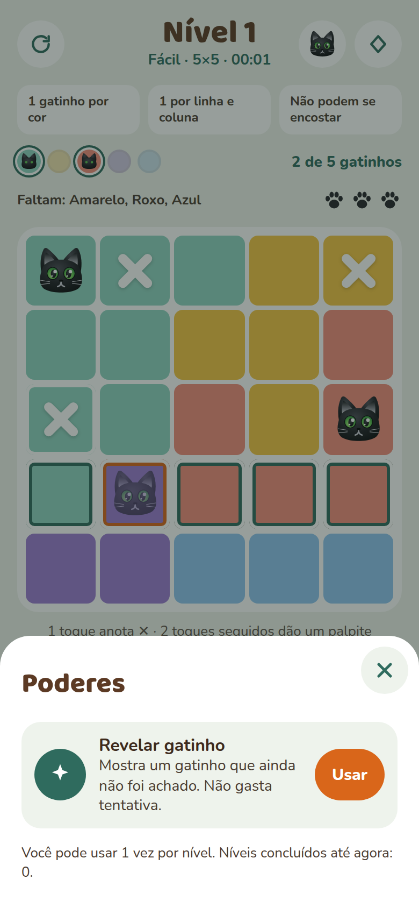
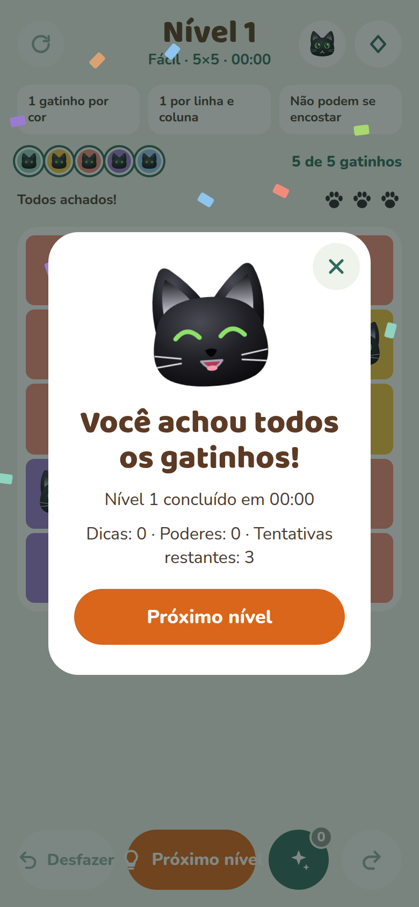
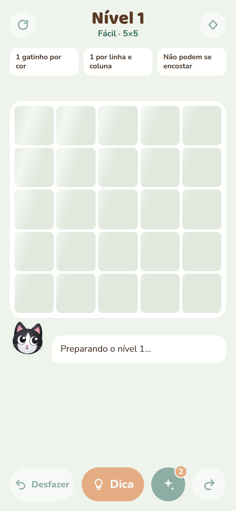

<h1 align="center">🐱 Gatinhos</h1>

<p align="center">
  Um quebra-cabeça zen de lógica: ache o gatinho escondido em cada cor.<br/>
  <a href="https://paulokmatos.github.io/gatinhos/"><b>▶ Jogar agora</b></a> · funciona no navegador e instala como app (PWA)
</p>

<p align="center">
  
  &nbsp;&nbsp;
  
</p>

## 📜 Como jogar

O tabuleiro é dividido em **cores**. Seu objetivo é encontrar **um gatinho em cada cor**, seguindo três regras:

| | Regra |
|---|---|
| 🎨 | **1 gatinho por cor** |
| ↔️↕️ | **1 gatinho por linha e por coluna** |
| 🚫 | **Gatinhos não podem se encostar**, nem na diagonal |

Quando todos os gatinhos forem achados, o nível termina. 🎉

### Controles

- **Toque uma vez** numa casa para marcar ✕ (a marca ✕ é só a *sua anotação*: nunca é colocada sozinha e pode estar errada).
- **Dois toques seguidos na mesma casa = 1 palpite:** se há um gatinho ali, ele aparece 🐱; se não há, é um palpite errado: o fundo escurece e uma patinha grande é rasgada no centro da tela, e você perde uma tentativa. Ter ou não uma marca ✕ na casa não importa; só importa haver mesmo um gatinho.
- **Arraste para marcar:** passe o dedo (ou o mouse) sobre casas vazias e as marcas ✕ aparecem enquanto você passa, todas desfeitas de uma vez com um único Desfazer.
- **Desfazer / Refazer** voltam e repetem só as suas marcas ✕. Gatinho é escrita do jogo: depois de revelado, nunca é desfeito.
- **Recomeçar nível** (⟲, canto superior esquerdo) pede uma confirmação e, se você confirmar, limpa o tabuleiro e devolve as 3 tentativas. Os gatinhos continuam nos mesmos lugares: nada é gerado de novo.
- **Seu nome** (o círculo ao lado dos símbolos) é opcional e fica só neste aparelho; aparece no parabéns ao vencer.
- **Símbolos** (◇, canto superior direito) mostram um símbolo em cada cor, para ajudar quem tem dificuldade de distinguir tons.

### Tentativas e progresso

- Você tem **3 tentativas por nível** (as patinhas ao lado do tabuleiro). Gasta uma quando você dá um palpite numa casa que **não** tem gatinho. Desfazer não devolve tentativa.
- Acima do tabuleiro, as bolinhas mostram **quais cores já têm gatinho** (com o gatinho dentro) e quais ainda faltam, com os nomes ao lado.

<p align="center">
  
  
  
</p>

<p align="center">
  
  
  
  
  
</p>

- **Sem tentativas?** Um aviso oferece **Tentar novamente** (recomendado) ou **Continuar sem limite**. Se você fechar o aviso (✕), o tabuleiro fica congelado e a barra de baixo mostra só **Tentar novamente** e **Próximo nível**.
- **Venceu?** Um aviso mostra seu tempo e as dicas usadas, com botão **Próximo nível** (e um ✕ para fechar e admirar o tabuleiro).

### ✨ Poderes

O botão **✨** abre os poderes. Por enquanto existe o **Revelar gatinho**: mostra um gatinho que ainda não foi achado (o da cor mais difícil de deduzir), sem gastar tentativa. Você pode usar **1 vez por nível** (recomeçar o nível devolve o uso).

### 📈 Progressão

- **Níveis 1–30:** etapas de 5 níveis, o tabuleiro cresce de **5×5 → 6×6 → … → 10×10** (Fácil → Médio → Difícil).
- **Depois do 30:** a maioria é **10×10** (todo nível múltiplo de 5 é 9×9, um respiro) e, **a cada 10 níveis, o patamar sobe**: 31–40 Difícil, 41+ Expert.
- **Gatinho de brinde:** nas dificuldades altas (a partir do nível 21) o nível pode já começar com 1 gatinho revelado, marcado com contorno tracejado. A chance é 50% nos níveis 21–30, 60% nos 31–40 e cai 15 pontos a cada 10 níveis, chegando a 0 no nível 71 — um empurrãozinho que some conforme você evolui. O sorteio é fixo por nível (igual em qualquer aparelho).
- **Salvo no seu aparelho:** o nível atual, a partida em andamento, o seu nome, níveis concluídos e melhores tempos ficam no `localStorage` do navegador. Cada aparelho tem o próprio progresso, sem conta nem servidor.

## 🔄 Atualizações e começar de onde quiser

- **O app se atualiza sozinho, sem aviso na tela.** Ele procura versão nova ao abrir, ao voltar para o app e de hora em hora. A versão nova é baixada em segundo plano e só passa a valer quando você sai do app (ou na próxima abertura) — nunca recarrega no meio de uma partida. Seu nome, progresso e partida em andamento ficam no aparelho e continuam valendo. A versão instalada aparece, discreta, no rodapé da folha do seu nome.
- **Você não precisa começar do zero.** Duas formas de ir direto para um nível avançado (por exemplo, já nos 10×10):
  - abra o jogo com `?nivel=26`, por exemplo `https://paulokmatos.github.io/gatinhos/?nivel=26` (os níveis 26–30 já são 10×10; do 31 em diante quase tudo é 10×10, e a partir do 41 é Expert);
  - ou toque no círculo do seu nome → **Ir para um nível** → **Começar nesse nível**.
  O app passa a retomar desse nível. Você pode voltar a qualquer nível da mesma forma.

## 💡 3 dicas para começar

1. **Comece pelas cores pequenas.** Uma cor com poucas casas (ou numa linha/coluna só) tem pouquíssimos lugares possíveis para o gatinho.
2. **Gatinho achado = marque ✕ ao redor.** Na linha, na coluna, na mesma cor e nas 8 casas vizinhas, ninguém mais pode ficar. Marque ✕ nelas para limpar a cabeça.
3. **Travou? Peça a Dica.** Toque em **Dica** até 3 vezes: o 1º mostra *o porquê* (as casas do motivo ficam destacadas, ex.: "a cor Roxo só tem casas na linha 5"), o 2º diz *o que fazer* (as casas a riscar ficam em laranja) e o 3º oferece **Fazer por mim**. Só esse passo conta como dica usada.

---

## 🛠️ Desenvolvimento

```sh
npm install
npm run dev        # servidor local
npm test           # testes automatizados (Vitest)
npm run build      # typecheck + build de produção
```

**Estrutura**

- `src/core/` — lógica pura e testável: modelo, validador, gerador (seed + unicidade), solver de força bruta, solver humano T1–T7, dicas, estado do jogo (desfazer, tentativas), persistência.
- `src/ui/` — interface (toque/arrasto, dicas, modais). A preparação dos níveis roda num Web Worker.
- `tests/` — testes por marco; cada um cita o critério de aceite (CA01–CA25).
- `docs/` — imagens deste README.

**Técnicas do solver humano** (usadas na dificuldade e nas dicas): T1 único · T2 cor numa linha/coluna · T3 linha/coluna numa cor · T4 vizinhança · T5 N cores em N linhas/colunas · T6 N linhas/colunas em N cores · T7 hipótese de profundidade 1.
Dificuldade: T1–T2 Fácil, T3–T4 Médio, T5–T6 Difícil, T7 Expert.

**CI** (`.github/workflows/ci.yml`): typecheck + testes → build → deploy no GitHub Pages (só em `main`).
Para **pular os testes**: `[skip tests]` na mensagem do commit, label `skip-tests` no PR, ou "Pular os testes" ao disparar manualmente. O build e o deploy continuam rodando.

Enquanto o Worker prepara um nível grande, aparece um esqueleto animado do tabuleiro com o gatinho de dica.

**Pendente no aparelho:** CA03 (arrasto), CA09 (long task), CA17, CA21–CA25 (instalação, offline, safe areas, roteiro no iPhone).

> A partida salva no navegador **não guarda a solução**: ela é recalculada das cores ao carregar. Como o jogo roda inteiro no aparelho, isso evita espiadas casuais, mas não é um segredo de verdade.
